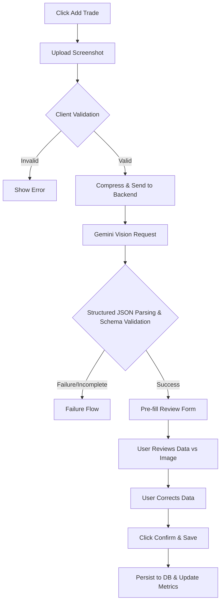

# User Flows: Tradelense

## 1. Document Purpose
This document provides the professional User Flows specification for the Tradelense commercial SaaS. It details how users navigate the product from their initial visit through long-term daily usage. It bridges the feature definitions in the Feature Specification (`docs/02_FEATURE_SPECIFICATION.md`) with the actual step-by-step user experience, defining states, success/recovery paths, and end-to-end journeys.

## 2. User Roles and States
- **Anonymous Visitor:** Unauthenticated user browsing the public landing page, pricing, and login/signup auth flows.
- **Authenticated Free User:** Registered user with access to core journaling, manual entry, baseline dashboard metrics, and strictly limited AI interactions.
- **Authenticated Pro User:** Paying subscriber with unlimited/higher tier access to AI trade scans, AI Coach, Behavioral Intelligence, and advanced analytics.
- **System Role:** Automated background worker handling webhooks, asynchronous AI processing, and scheduled data maintenance.

## 3. Global Navigation Model
The primary application shell features a persistent navigation model (sidebar on desktop, hamburger/bottom bar on mobile).
- **Dashboard:** Overview of active month performance, equity curve, recent trades.
- **Journal:** Sortable, filterable list of all logged trades.
- **AI Scan (Add Trade):** Primary action button always accessible.
- **Analytics:** Deep dive into strategy, time, and setup performance.
- **Behavioral Intelligence:** (Pro) Insights into emotional tags, mistakes, and discipline.
- **AI Coach:** Chat interface for personalized performance review.
- **Settings:** Account, profile, preferences, export, billing.

## 4. First-Time Visitor Flow
1. **Entry Point:** User lands on `tradelense.com`.
2. **Product Understanding:** User reads Value Proposition ("Your AI Trading Journal OS").
3. **Free/Pro Understanding:** User views Pricing section highlighting AI capabilities in Pro.
4. **Action:** User clicks "Get Started for Free".
5. **System Response:** Redirects to Signup flow.
6. **Success State:** User creates account, proceeds to Onboarding.

## 5. Authentication Flows
### Sign Up / Sign In
- **Preconditions:** Unauthenticated state.
- **User Action:** Enters email/password or selects OAuth.
- **System:** Validates credentials.
- **Success:** Auth token generated, redirects to Dashboard.
- **Failure:** Inline validation error ("Invalid credentials", "Email exists").

### Password Recovery
- **User Action:** Clicks "Forgot Password" on login.
- **System:** Emails reset link.
- **User Action:** Clicks link, enters new password.
- **Success:** Password updated, auto-logins.

### Session Expiration
- **Preconditions:** JWT token expires and refresh fails.
- **System:** Intercepts next API call, logs user out locally, redirects to login with message: "Session expired. Please sign in again."

## 6. First-Time User Onboarding
- **Preconditions:** First successful login.
- **Step 1 (Profile):** System prompts for Timezone verification and preferred starting base currency.
- **Step 2 (Welcome):** Brief dismissible modal ("Welcome to your AI Trading OS").
- **Step 3 (Empty State):** User lands on Dashboard. Dashboard shows Zero metrics and a clear primary call to action: "Add Your First Trade".

## 7. Dashboard Flow
- **Entry point:** Completing sign-in.
- **System Response:** Fetches current month aggregate analytics and 5 most recent trades.
- **User Action:** Explores metrics (Net PNL, Win Rate, RR, Total Executions, Average Duration, Current Streak).
- **User Action:** Views PNL equity curve chart.
- **Decision Point:** Click "View Analytics" for deep dive OR click a recent trade to open Trade Review Flow.

## 8. Manual Trade Entry Flow
1. **Entry Point:** Navigates to Journal or clicks global "Add Trade" button.
2. **Action:** Selects "Manual Entry".
3. **Action:** Enters instrument, direction, entry/exit prices, size, dates/times, and tags.
4. **Validation:** System checks for missing required fields and ensures prices are valid numbers.
5. **Action:** User clicks "Save".
6. **System Response:** Validates, writes to DB, recalculates dashboard analytics asynchronously.
7. **Success State:** Trade appears at the top of the Journal; success toast shown.
8. **Failure State:** Toast shows submission error (e.g., "Network error"); form data is retained for retry.
9. **Cancel:** Discards draft, returns to previous route.

## 9. AI Screenshot Trade Scan Flow [P0]
This is the core commercial differentiator.

1. **AI Processing:** User uploads image. UI shows processing animation.
2. **User Review:** System presents extracted data in a form alongside the screenshot.
3. **User Confirmation:** User explicitly validates extraction, fixes any minor parsing errors.
4. **Persistence:** Data is saved ONLY when the user clicks Confirm.

## 10. AI Failure Flow [CRITICAL]
*Rule: AI failure must NEVER produce fake values, fake OCR, fake confidence scores, or automatic persistence.*

- **Condition:** Gemini unavailable, API timeout, unreadable screenshot, missing critical schema keys.
- **System Response:** Halts extraction pipeline immediately.
- **User-Facing Behavior:** Closes loading state, opens a completely blank manual entry form with the image attached, and displays a prominent warning: "AI Extraction Failed: Unable to confidently read trade data. Please enter details manually."
- **Recovery Path:** User types details manually or clicks "Upload different image".

## 11. Trade Review Flow
- **Entry:** User clicks a trade row in the Journal.
- **Action:** Views trade summary, reads personal notes, reviews the attached screenshot (enlargeable).
- **Exit:** Closes modal/view to return to Journal.

## 12. Trade Editing Flow
- **Entry:** From Trade Review, user clicks "Edit".
- **Action:** Modifies stop loss, emotional tags, or adds missed fees.
- **System:** Validates new inputs. Recalculates `risk_reward_ratio` or `pnl` if inputs changed.
- **Success:** Overwrites DB row, toasts success, triggers analytics background refresh.

## 13. Trade Deletion Flow
- **Action:** User clicks "Delete Trade".
- **System:** Prompts confirmation modal ("Are you sure? This affects your analytics").
- **Action:** User confirms.
- **System:** DB soft/hard deletes record, deletes image from Storage. Dashboard recalculates.

## 14. Journal Exploration Flow
- **Entry:** User opens Journal.
- **Action:** Uses column headers to sort by Date or PNL.
- **Action:** Opens filter menu, selects "Date: Last 30 Days", "Direction: Short".
- **System:** Re-fetches data matching parameters.

## 15. Analytics Exploration Flow
- **Entry:** User navigates to Analytics.
- **Action:** Selects "Performance by Day of Week".
- **System:** Groups trades by day, plots Win Rate and Average PNL.
- **State Handling:** If a day has 0 trades, it shows a 0-state. If sample size is < 5, UI adds an "Insufficient Data" badge to prevent implied causation.

## 16. Behavioral Intelligence Flow
- **Entry:** User navigates to Behavioral Intelligence tab.
- **System:** Runs heuristic checks on journal data (e.g., checking strings in `execution_mistakes`, correlation of losses to `emotional_state=FOMO`).
- **Success State:** Displays specific insights: "You have tagged 'FOMO' on 8 trades this month. Your win rate on these trades is 20% compared to your 55% average."
- **Review:** User clicks the insight to view a pre-filtered list of those 8 specific trades.

## 17. AI Coach Flow
- **Entry:** User clicks AI Coach icon.
- **Action:** User selects a suggested prompt: "Review my recent losing streak."
- **System:** Backend fetches user's last 20 trades and aggregate metrics, constructs a grounded prompt, sends to Gemini.
- **System Response:** Streams text separating *Observation* (e.g., "I see you took 5 consecutive losses on Gold"), *Interpretation* (e.g., "Your holding time dropped drastically"), and *Recommendation* (e.g., "Review your 15-minute timeframe confirmation rules").
- **Data Integrity:** The Coach strictly cites specific provided trades and does not invent alternative market histories.

## 18. Free Plan Usage Limit Flow
- **Condition:** Free user initiates an AI Scan. System checks quota (e.g., 4/5 used).
- **System Response (Approaching):** Appends subtle warning: "1 AI scan remaining this billing cycle."
- **Condition:** Limit Reached.
- **System Response:** AI Scan blocked. Modal appears: "You've reached your free AI limit for this month. Upgrade to Pro for unlimited AI scans and advanced behavioral intelligence."
- **Action:** User clicks "Upgrade" (triggers Flow 19).

## 19. Upgrade to Pro Flow
- **Entry:** User hits limit or clicks "Upgrade" in Settings.
- **Action:** Views plan comparison matrix.
- **Action:** Clicks "Subscribe via Stripe".
- **System:** Generates Stripe Checkout Session, redirects user.
- **Action:** User completes payment securely on Stripe.
- **System:** Stripe redirects to `/success`. Webhook fires asynchronously to update `users` table entitlements.
- **Success State:** UI detects Pro entitlement, unlocks AI fields and Advanced Analytics immediately.

## 20. Billing Failure Flow
- **Condition:** Stripe webhook reports `invoice.payment_failed` for renewal.
- **System Response:** Downgrades user entitlement to Free.
- **User-Facing State:** Next login, banner displays: "Your subscription payment failed. Your account has been reverted to the Free plan. Update your payment method in Settings."

## 21. Export Flow
- **Entry:** Settings -> Export Data.
- **Action:** Selects "CSV" for "All Time".
- **System:** Generates CSV file from DB, triggers browser download.
- **Success:** File downloads locally.

## 22. Account/Data Deletion Flow
- **Entry:** Settings -> Danger Zone -> Delete Account.
- **Action:** Clicks delete.
- **System:** Forces a password re-entry modal for security.
- **Action:** User confirms password and types "DELETE".
- **System:** Hard deletes all storage buckets/images, cascades delete across `trades` table, deletes Auth record, invalidates session, redirects to public landing page.

## 23. Error Handling Flow
- **Strategy:** Never leave the user hanging.
- **Network loss during save:** Don't clear the form. Show inline error, allow retry.
- **API 500:** Show generic "Service unavailable" toast, log technical details to monitoring system (e.g., Sentry) securely.
- **No misleading success:** A 200 OK must only happen if the database transaction committed.

## 24. Loading and Empty States
- **First Dashboard:** Displays beautiful "Zero State" prompting the first manual or AI trade.
- **Empty Analytics:** Renders ghosted/watermarked charts with "Log more trades to unlock insights".
- **AI Processing:** Uses glowing/terminal-style indeterminate progress bars indicating Gemini is working.
- **Saving:** Disables submit buttons and shows spinners to prevent duplicate submissions.

## 25. Responsive/Mobile Flow Considerations
- **Desktop:** Multi-column layouts. Trade form beside screenshot preview.
- **Tablet:** Collapsible sidebars, fluid grids.
- **Mobile:** Full-screen views. AI Scan utilizes native mobile camera roll. Complex data tables convert to stacked vertical cards.

## 26. Permission and Security Flow
- **Unauthenticated:** Forced redirect to `/login`.
- **Cross-user access:** RLS blocks access. Database returns 404 (Not Found) or empty arrays if a user attempts to fetch `trade_id=X` belonging to another user.
- **Feature gating:** API endpoints for Pro features verify Stripe status before executing.

## 27. End-to-End Primary User Journey
1. **Visitor** lands on marketing page.
2. **Signs up** via email.
3. Completes lightweight **Onboarding**.
4. Lands on empty **Dashboard**.
5. Clicks "Add Trade" and tests the **AI Scan**.
6. Uploads MT4 screenshot. System extracts data successfully.
7. **Reviews** data, corrects one digit in the stop loss, clicks confirm.
8. Trade saves. **Dashboard** instantly displays a $150 PNL and 100% win rate.
9. Fast forward 30 days: User opens **Behavioral Intelligence** and realizes they lose money on Fridays.
10. Opens **AI Coach** to ask for a Friday strategy.
11. Hits quota limit.
12. Enters **Pro upgrade checkout**, succeeds, and receives their customized caching session.

## 28. Critical Failure Journeys
- **AI Scan Failure:** Upload image -> Gemini times out -> Error boundary catches exception -> Blank form presented with "AI timeout. Please manually enter" -> User manually logs trade successfully -> No data lost, no fake data created.
- **Authentication Failure:** Token expires during a 2-hour session -> User clicks save on a trade -> API returns 401 -> Global interceptor catches 401 -> Saves draft to `localStorage` -> Redirects to login -> User logs in -> Form restores from draft.

## 29. Flow Acceptance Criteria

### First-Time Onboarding [P0]
- **Given** a user has just verified their email and logged in for the first time, **When** they load the application, **Then** they must be shown the timezone configuration modal before accessing the dashboard.

### AI Scan Review [P0]
- **Given** an image has been processed by Gemini, **When** the structured data is presented to the user, **Then** the "Save Trade" action must require explicit user interaction and must not auto-submit.

### Pro Entitlement Lock [P0]
- **Given** an authenticated Free user, **When** they try to access the `GET /api/analytics/advanced` endpoint directly, **Then** the system must return a 403 Forbidden response.

## 30. Flow Dependencies
- **Authentication** is prerequisite for ALL flows.
- **Journal Storage (DB)** is prerequisite for **AI Scan Review Persistence**.
- **Journal Storage (DB)** feeds **Dashboard**, **Analytics**, and **Behavioral Intelligence**.
- **Analytics Aggregation** + **Journal History** + **Behavioral Labels** form the prompt context for the **AI Coach**.
- **Subscription Service (Stripe)** intercepts and modifies routing for **AI Coach** and **AI Scan** limits.

## 31. Open Decisions
*The following UX decisions are deferred:*
- Exact number of quota limits for the Free tier.
- Choice of primary payment provider (Stripe assumed conceptually, but flexible).
- Specific UI layout for the Behavioral Intelligence reporting charts.
- Extent of offline capability / PWA support.

## 32. Document Governance
This document (`docs/03_USER_FLOWS.md`) serves as the definitive flow-level source of truth. It adheres strictly to the product vision in `docs/01_PRODUCT_REQUIREMENTS.md` and the feature lists in `docs/02_FEATURE_SPECIFICATION.md`.

**Next Document:** `docs/04_BUSINESS_MODEL.md`
