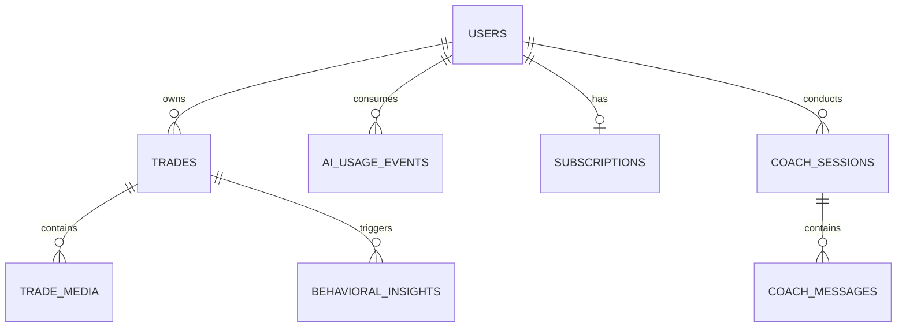

# Database Architecture: Tradelense

## 1. Executive Summary
This document defines the target production database architecture for the Tradelense commercial SaaS. It specifies the logical data models, user isolation strategies, and data integrity principles built upon Supabase PostgreSQL. This document strictly ensures that AI extraction data is ephemeral and distinct from canonical trade data, enforces commercial usage quotas, and establishes Row Level Security (RLS) as the absolute boundary for multi-tenant data privacy. 

## 2. Database Architecture Goals
- **Absolute Isolation:** Users cannot access or infer data belonging to other users.
- **Financial Integrity:** Numeric precision is preserved; deterministic calculations rely on raw persisted facts, not AI approximations.
- **AI Separation:** AI payload results do not implicitly corrupt or populate canonical journal data without explicit human validation.
- **Commercial Quota Safety:** Server-driven usage counters ensure Free vs. Pro boundaries are financially secure.
- **Auditability:** Sensitive operations (subscription changes, large deletions) trace back to user/system actions.
- **Supabase native:** Maximizes RLS and backend middleware integration rather than duplicating RDBMS constraints in application code.

## 3. Logical Data Model


## 4. Identity and Account Model
Relies entirely on Supabase Auth `auth.users`. Application-specific data lives in a linked `profiles` (or `accounts`) table.
The UUID assigned by Supabase Auth acts as the ultimate Foreign Key (`user_id`) for every isolated record in the database.

## 5. User/Profile Model
Extends `auth.users` to store commercial SaaS data: display name, preferred timezone, base currency, and high-level entitlement flags.

## 6. Trades Model
The canonical journal.
- **USER-PROVIDED:** Explicit inputs (e.g., tags, verified numbers, manual notes).
- **AI-EXTRACTED:** Fields initially sourced via Gemini but explicitly confirmed/committed by the user. (Once saved, they are treated identically to user-provided).
- **SYSTEM-DERIVED:** Deterministic values computed safely (e.g., `net_pnl = gross_pnl - fees` or `risk_reward_ratio = (take_profit - entry) / (entry - stop_loss)`). Cannot be overridden by user or AI.

## 7. Trade Lifecycle
**CRITICAL:** AI Extraction ≠ Persisted Trade.
When Gemini extracts data, it rests in application memory (or an ephemeral caching layer). It is ONLY written to the `trades` table when the HTTP request explicitly declares "User has reviewed and confirmed this payload." Failed AI extractions NEVER produce a trade row.

## 8. Trade Screenshot / Media Model
Screenshots are stored in Supabase Storage (`trade_media` bucket). The database holds a `trade_media` table connecting the `trade_id` to the storage object path (`file_path`). This permits one trade to have multiple screenshots (e.g., entry chart + exit chart).

## 9. AI Extraction Model
*Does not require a persistent canonical table.* AI extraction requests and their raw responses are ephemeral. If auditing is required, they can be logged as JSONB payloads into an `audit_events` or `ai_usage_events` log, but they must strictly never be queried as source-of-truth trades.

## 10. AI Usage Model
A transactional ledger (`ai_usage_events`) recording tokens, request timestamps, and feature types (e.g., `SCAN`, `COACH`). Required for enforcing the strict monthly quotas on Free and Pro tiers.

## 11. Behavioral Intelligence Model
A table bridging `trades` to detected psychological patterns. Examples: A cron job analyzes trades, detects "widened stop loss 3 times", and inserts a record into `behavioral_insights` linking back to those specific `trade_ids`.

## 12. Analytics Data Model
Derived at runtime via SQL Aggregations or Materialized Views (for performance). Examples: `Win Rate`, `Monthly PNL`, `Average RR`. No raw analytics cache table is required for MVP unless performance dictates it.

## 13. AI Coach Data Model
Conversational logs between User and Gemini.
- `coach_sessions`: Represents a conversation thread.
- `coach_messages`: Contains the prompt, the Gemini response, and token usage, mapped to a session.

## 14. Subscription Data Model
Tracks Stripe mapping. Translates external customer IDs to internal UUIDs. Stores `status` (active, past_due, canceled), `current_period_end`, and `price_id`. 

## 15. Entitlement Model
Derived locally via SQL views or middleware looking at `subscriptions`. Determines if the user is Free, Pro, or Admin.

## 16. Usage / Quota Model
Aggregates `ai_usage_events` against `subscriptions` to yield a boolean: `can_user_request_ai_scan()`. Must be bulletproof and server-authoritative.

## 17. Settings Model
Can be JSONB in the `profiles` table or a dedicated `user_settings` table. Stores UI themes, default chart layouts, and export preferences.

## 18. Export Model
Generated asynchronously. If extensive, generated exports are temporarily stored in Supabase Storage and a short-lived signed URL is provided.

## 19. Audit / Security Event Model
Immutable append-only `audit_events` table for critical state changes: email modifications, password resets, subscription tier upgrades/downgrades.

## 20. Ownership and Authorization Model
| Entity | Owner | Access Rule |
| :--- | :--- | :--- |
| `profiles` | `auth.uid()` | SELECT/UPDATE own |
| `trades` | `auth.uid()` | CRUD own |
| `trade_media` | `auth.uid()` | CRUD own |
| `subscriptions` | `auth.uid()` | SELECT own (System updates) |
| `ai_usage_events`| `auth.uid()` | SELECT own (System updates) |

## 21. Row Level Security Strategy
RLS MUST be enabled on every table containing user data.
Example:
```sql
ALTER TABLE trades ENABLE ROW LEVEL SECURITY;
CREATE POLICY "Traders govern their own trades" ON trades
  FOR ALL USING (auth.uid() = user_id);
```

## 22. Service-Role / Privileged Access
The Supabase `service_role` key bypasses RLS. It is strictly reserved for backend webhooks (e.g., Stripe updating subscriptions) and async worker crons (e.g., generating behavioral insights). NEVER passed to the browser.

## 23. Foreign Keys and Referential Integrity
Strict relational integrity. If a `trade` is deleted, its `trade_media` rows cascade delete. `user_id` MUST be enforced as a non-null foreign key referencing `auth.users(id)` universally.

## 24. Deletion and Data Lifecycle
- **Subscription Cancellation:** Updates `subscriptions` status. Downgrades entitlements. Trade data is preserved.
- **Account Deletion:** Hard-deletes Auth user. Cascades through entire DB schema eliminating all trades, profile data, and media.

## 25. Soft Delete vs Hard Delete
*OPEN PRODUCT/DATA DECISION:* Should trades be soft-deleted (retained with a `deleted_at` flag) for recovery, or hard-deleted instantly? (Implementation defaults to Hard Delete for V1 simplicity unless instructed otherwise).

## 26. Data Retention
*OPEN LEGAL/PRIVACY DECISION:* Define how long data is held after an account goes inactive or is deleted.

## 27. Indexing Strategy
Heavily index `user_id` on all tables to optimize RLS policies. Index `entry_time` and `exit_time` on `trades` for rapid dashboard chronological aggregations.

## 28. Constraints and Validation
DB-level check constraints ensure impossible scenarios cannot be saved (e.g., `CHECK (take_profit >= entry_price)` for Long trades, or ensuring `pnl` is mathematically aligned if strict tracking is adopted).

## 29. Financial Data Integrity
- Use `NUMERIC` or `DECIMAL` types for precise financial math (Price, Position Size, PNL). NEVER use `FLOAT` or `REAL` to prevent floating-point rounding errors.
- System calculates `pnl` / `rr` in application space or via rigid SQL trigger rules. AI is explicitly banned from altering these authoritative values.

## 30. Timezone Strategy
All `TIMESTAMP` columns must be `TIMESTAMPTZ` (UTC). User-specific presentation is explicitly handled by the application layer rendering UTC against the user's `profiles.timezone` preference.

## 31. Currency Strategy
*OPEN PRODUCT DECISION:* Does V1 enforce a single fiat currency (e.g., USD standard), or allow a user-level base currency?

## 32. Data Privacy
Isolate PII (Email, Name) into `profiles`. Strict adherence to isolation means no query should ever unintentionally aggregate trade data across users for public leaderboards unless explicitly opted-in (Out of scope for V1).

## 33. Backup and Recovery
Handled natively via Supabase Point-In-Time Recovery (PITR).

## 34. Migration Strategy
Database changes occur strictly through version-controlled sequential SQL migrations (e.g., via Supabase CLI or Prisma if utilized) verified in a staging environment before prod execution.

## 35. Development vs Production Data
**Local JSON/mock data is development-only.**
Supabase PostgreSQL is the absolute, undisputed production source of truth. Production data isolation relies exclusively on RLS and valid JWTs.

## 36. Database Failure Modes
| Failure | Impact | Detection | Response |
| :--- | :--- | :--- | :--- |
| **Connection Pool Exhaustion** | 500 API Errors | High latency / DB timeout alerts | Scale PgBouncer / Optimize missing indices |
| **Webhook RLS failure** | Subscriptions missed | Stripe retry queue failing | Ensure webhook proxy uses `service_role` |

## 37. Database Security Risks
- **Missing RLS:** Catastrophic horizontal data leakage. Mitigated by CI/CD scripts ensuring RLS is active on all new tables.
- **Service-Role Exposure:** Bypasses all security. Client-side code must NEVER contain the secret key.
- **Unauthorized Exports:** Prevented by RLS scoping export queries exactly to `auth.uid()`.

## 38. Scalability Considerations
V1 relies on standard Postgres indexing. Future scaling involves Database Sharding by User ID or read-replicas for heavy analytic querying.

## 39. Proposed Table Inventory

| Table | Purpose | Owner | Criticality | Lifecycle |
| :--- | :--- | :--- | :--- | :--- |
| `profiles` | Account details | `user_id` | High | User lifetime |
| `trades` | Canonical journal | `user_id` | High | User lifetime |
| `trade_media` | Image metadata | `user_id` | Medium | Linked to Trade |
| `ai_usage_events`| Quota tally | `user_id` | High | Rolling 30 days |
| `subscriptions` | Billing state | `user_id` | High | User lifetime |
| `coach_sessions` | AI chat context | `user_id` | Low | Ephemeral/Pruned |

*Omitted: `ai_extractions` - Extraction is ephemeral memory, not canonical DB state.*

## 40. Schema Naming Conventions
- Table names: `snake_case` plural (e.g., `trades`).
- Column names: `snake_case` (e.g., `entry_price`).
- Primary keys: `id` (UUID default `gen_random_uuid()`).
- Foreign keys: `singular_table_name_id` (e.g., `user_id`).
- Timestamps: `created_at`, `updated_at` (timestamptz).
- JSONB: Used sparingly, only for untyped external data (Stripe raw payloads).

## 41. Architecture Decision Records

- **ADR-DB-001:** Supabase PostgreSQL is production source of truth.
  - *Reason:* Relational integrity and built-in Auth.
  - *Status:* Accepted.
- **ADR-DB-002:** Every user-owned entity has explicit ownership (`user_id`).
  - *Reason:* Prerequisite for multi-tenant SaaS safety.
  - *Status:* Accepted.
- **ADR-DB-003:** RLS is required for production isolation.
  - *Reason:* Defense in depth beneath the API layer.
  - *Status:* Accepted.
- **ADR-DB-004:** AI extraction is separate from persisted trades.
  - *Reason:* Prevents hallucination injection into financial history. User MUST approve.
  - *Status:* Accepted.
- **ADR-DB-005:** Raw trade data is authoritative for analytics.
  - *Reason:* Determinism. Calculations happen dynamically.
  - *Status:* Accepted.
- **ADR-DB-006:** Usage events support commercial quota accounting.
  - *Reason:* Limits Pro API bankruptcy via Server checks.
  - *Status:* Accepted.
- **ADR-DB-007:** Screenshots use private storage with database metadata.
  - *Reason:* Storage bucket files map securely context via relational IDs.
  - *Status:* Accepted.

## 42. Open Database Decisions
- Exact multi-asset schema fields (e.g., differentiating Options strike prices vs Crypto token addresses).
- Strict soft-delete vs hard-delete strategy.
- Multi-currency support vs USD base default.
- Data retention timelines for inactive free users.

## 43. Database Acceptance Criteria
- [x] Defines target logical model for the specified V1 scope.
- [x] Fully specifies RLS and isolation mechanics.
- [x] Protects against AI extraction hallucination via distinct data lifecycle.
- [x] Ensures commercial quotas can be enforced server-side.
- [x] Aligns logically with Documents 01 through 05 without generating code/migrations.

## 44. Document Governance
- **Owner:** Database / Backend Architect.
- **Rules:** Schema migrations MUST be reviewed against this document and the product requirements. The UI cannot dictate missing constraints in the database layer. 
